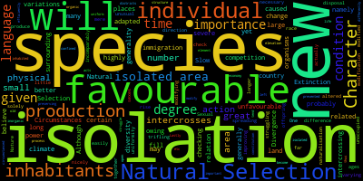
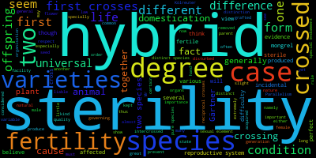

Origin of Species
#Had to download redownload conda
#Downloaded the word cloud using:
install -c conda-forge wordcloud
#Navigated to my assignment 1 folder
#Opened bash
#Downloaded the origin text and extracted the isolation and sterility using grep
curl -o origin.txt https://gutenberg.org/cache/epub/1228/pg1228.txt
grep -owi "sterility" origin.txt | wc -l
grep -owi "isolation" origin.txt | wc -l
#Made it into text files
grep -owi "sterility" origin.txt > sterility.txt
grep -owi "isolation" origin.txt > isolation.txt
#To conda - making a word cloud and putting it in file
Below is an image

And here is another

I would say that for the most part, Darwin did try to address the process that led to the formation of new species. He did consider the reproductive track that species must go down and how isolation can drive divergent evolution. However, the word clouds didn't specifically address how exactly species are made, word clouds aren't supposed to give an explanation, but show the most common concepts around the main subject.